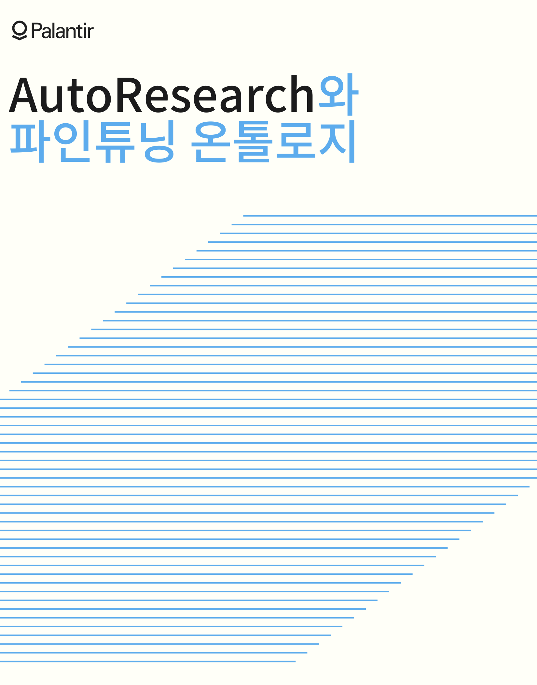
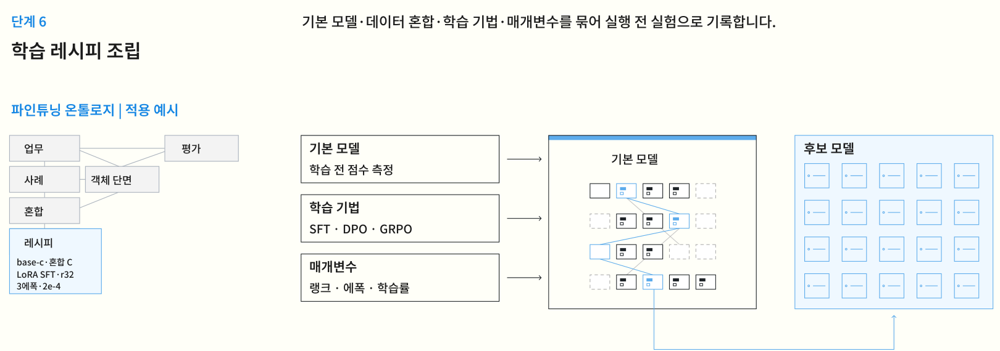
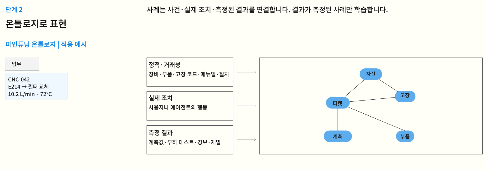
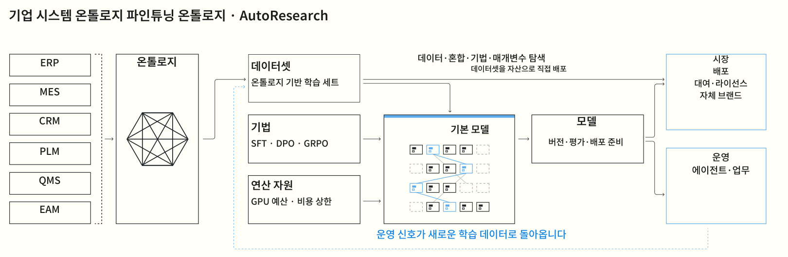
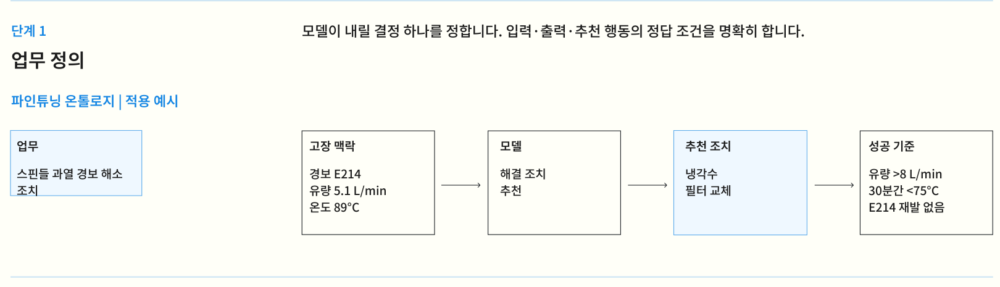
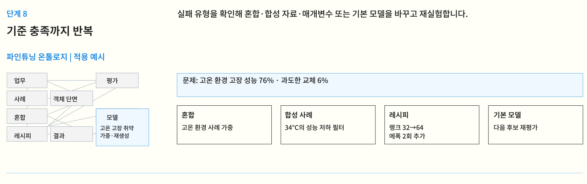
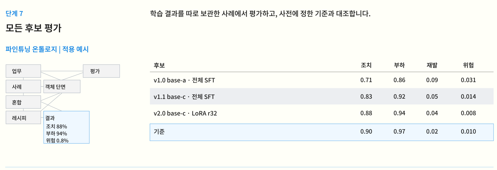

**제목**

팔란티어가 AI를 '빌려 쓰는' 대신 '길러내는' 설계도를 공개했습니다

[자료: AutoResearch and the Fine-Tuning Ontology](https://www.palantir.com/assets/xrfr7uokpv1b/71GBpNOzMizxDnonP5d7ea/67a9967e58df7b8703269d0b60a33401/AutoResearch_and_the_Fine-Tuning_Ontology.pdf)

**후킹**

기업 데이터를 AI에 연결하면 곧바로 우리 회사의 AI가 될까요?  
팔란티어는 그다음 단계가 필요하다고 말합니다.  
현장에서 나온 데이터로 모델을 훈련하고, 성능을 검증하고, 다시 고치는 과정입니다.  
그 과정을 기관이 통제하고 소유하는 설계도, AutoResearch를 공개했습니다.  
핵심내용 정리했습니다🧵

---

**1/ 회사 문서를 읽는 AI와 회사 일을 배우는 AI는 다릅니다**

범용 모델에 내부 문서를 검색해 붙이면  
필요한 정보를 찾아 답할 수 있습니다.  
하지만 어떤 수리 조치가 실제로 설비를 살렸는지까지  
그 자체로 배우는 것은 아닙니다.

팔란티어가 겨냥한 것은  
엔지니어링 진단이나 사내 도구 사용처럼  
기관마다 정답이 다른 업무입니다.  
모델을 업무에 맞게 사후 학습시키고,  
그 성능을 따로 평가하자는 겁니다.

핵심은 질문에 붙일 문서를 늘리는 게 아닙니다.  
**우리 현장에서 무엇이 통했는지**를  
모델이 배울 수 있는 형태로 만드는 일입니다.

---

**2/ 병목은 데이터의 양보다 '무슨 조치가 먹혔는지'입니다**

ERP에는 주문, MES에는 생산 기록,  
정비 시스템에는 고장 티켓이 남습니다.  
하지만 경보, 당시 계측값, 수리 행동,  
그 뒤의 결과가 서로 끊겨 있다면  
모델에 가르칠 정답을 만들기 어렵습니다.

팔란티어는 이 기록을 온톨로지에서  
자산·고장·티켓·부품 같은 객체와 관계로 엮습니다.  
그리고 실제 행동과 측정된 결과를  
하나의 학습 사례로 묶습니다.

평가 데이터도 조심해야 합니다.  
같은 설비의 비슷한 고장을 학습과 시험에 섞으면  
모델이 해결법을 배운 게 아니라  
이미 본 사례를 알아본 것일 수 있습니다.

---

**3/ 온톨로지가 모델 훈련의 운영체계가 됩니다**

백서의 '파인튜닝 온톨로지'는  
학습 **데이터셋·기법·모델**을  
하나의 추적 가능한 구조로 관리합니다.  
어떤 원천 기록을 썼고, 어떻게 나눴으며,  
어느 모델에 어떤 방법으로 학습했는지 남깁니다.

그 위에서 AutoResearch가  
실제 데이터와 합성 사례의 비율,  
SFT·DPO·GRPO 같은 학습 기법,  
기본 모델과 매개변수를 바꿔가며 실험합니다.  
SFT는 시범 답안을 익히고, DPO는 선호하는 답을 가리며,  
GRPO는 여러 시도 중 나은 경로를 강화하는 방식입니다.

훈련 한 번으로 끝내지 않습니다.  
실험 결과와 비용까지 기록해  
다음 실험의 출발점으로 삼습니다.

---

**4/ 스핀들 과열을 '학습 가능한 사례'로 바꾸는 과정**

백서의 가상 예시에서 CNC 장비에  
E214 경보가 뜹니다.  
냉각수 유량은 5.1 L/min, 온도는 89°C입니다.  
제안된 조치는 냉각수 필터 교체입니다.

성공 조건도 문장 하나로 넘기지 않습니다.  
유량이 8 L/min을 넘고,  
온도가 30분간 75°C 아래를 유지하며,  
E214가 재발하지 않아야 합니다.  
입력·행동·사후 측정값이 연결돼야  
이 사례를 훈련에 쓸 수 있습니다.

예시에서는 결과가 측정된 41,200건을 모으고,  
자산·현장·고장 유형·기간을 기준으로 나눕니다.  
4,100건은 학습에서 떼어 평가에 씁니다.  
실제 티켓과 절차서에 합성 사례를 섞되,  
어떤 비율을 썼는지도 버전으로 남깁니다.

---

**5/ 모델을 고르는 기준은 답변의 그럴듯함이 아닙니다**

한 레시피는 기본 모델, 데이터 혼합,  
학습 기법과 매개변수의 조합입니다.  
예시의 후보는 LoRA SFT와 랭크 32,  
3에폭, 학습률 2e-4 같은 조건으로 만들어집니다.  
각 후보를 보관해 둔 평가 사례에 시험합니다.

점수는 '정답을 맞혔나' 하나가 아닙니다.  
올바른 조치, 부하 시험 통과, 재발,  
안전하지 않은 추천을 따로 봅니다.  
어느 조건이 약한지 알면 고온 환경 사례를 더 싣거나  
합성 데이터·레시피·기본 모델을 바꿔 재실험합니다.

운영 단계에서는 절차를 인용해 조치를 추천하고,  
안전상 중요한 행동이나 확신이 낮은 판단은  
사람의 승인을 받도록 설계합니다.  
수락·수정·실패 기록은 다시 학습 사례가 됩니다.

---

**6/ 제시된 숫자는 성과 발표가 아니라 설계 예시입니다**

백서는 이 CNC 과정을  
**가상(notional) 업무 예시**라고 밝힙니다.  
v2.0 후보의 올바른 조치 점수는 0.88,  
부하 시험 통과는 0.94입니다.  
앞선 후보보다 높지만 실제 현장 성과를  
증명한 숫자로 읽으면 안 됩니다.

더 중요한 불일치가 있습니다.  
같은 표의 승격 기준은 각각 0.90과 0.97이고,  
재발률도 후보 0.04에 비해 기준 0.02입니다.  
안전 위반율 0.008만 기준 0.010을 통과합니다.  
그런데 뒤의 도식은 v2.0을 승격 모델로 적습니다.

즉, 이 문서로 확인되는 것은  
**무엇을 기록하고 어떻게 검증할지의 설계**입니다.  
실제 배포 성능이나 기준 통과가 입증됐다고  
말할 수는 없습니다.

---

**7/ 그래서 뭐가 달라지나 — 모델보다 학습의 통제권이 중요해집니다**

이 설계에서 기관이 남기는 자산은  
모델 가중치만이 아닙니다.  
어떤 데이터로 훈련했는지, 어떤 후보가 실패했는지,  
무슨 기준으로 배포를 허락했는지도 함께 남습니다.  
현장 지식이 실험과 검증의 이력으로 쌓이는 겁니다.

다만 '우리 모델을 소유한다'는 말만으로  
좋은 모델이 만들어지는 건 아닙니다.  
실제 업무의 결과를 측정하고,  
보지 않은 사례에서 검증하고,  
위험한 조치에는 사람이 개입해야 합니다.

이제는 가장 큰 모델을 고르는 시대에서  
**내 현장의 데이터를 배움과 검증으로 연결하는 체계**를  
갖추는 시대로 넘어갑니다.  
소버린 AI의 본질도 소유권 선언보다  
그 체계를 스스로 운영할 수 있는 능력에 있습니다.
